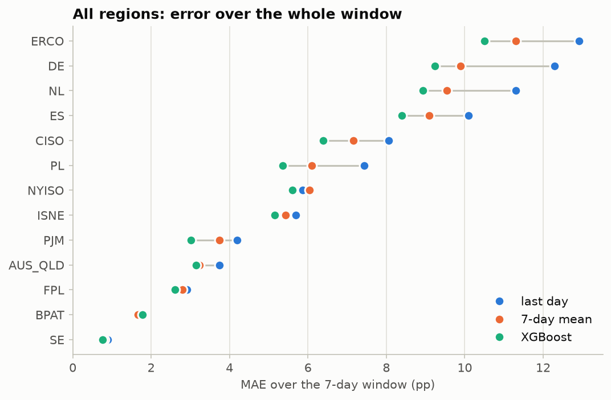
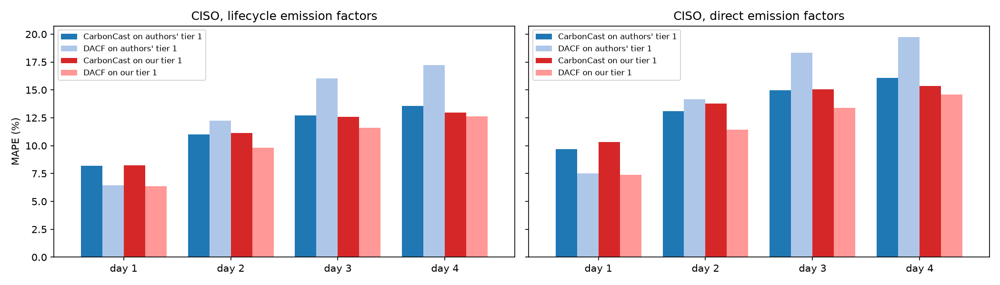

The `CarbonCast` directory is a git submodule of the original CarbonCast project. Both scripts read their data from it.

## Setup

You need git and [uv](https://docs.astral.sh/uv/getting-started/installation/).

```bash
git clone https://github.com/mborgos/CFE-forecast.git
cd CFE-forecast
git submodule update --init                     # downloads the CarbonCast data: about 190 MB, 0.9 GB on disk
uv sync                                         # creates .venv with Python 3.11 and the locked package versions
uv run python cfe_7day_baseline.py              # about 2 minutes
uv run python carboncast_ciso_reproduction.py   # about a minute the first time, from the cached forecasts
```

- **Data:** fetch it with `git submodule update --init` as above. Avoid `git clone --recurse-submodules`: it downloads every branch of CarbonCast, which is far larger.
- **macOS:** XGBoost needs the OpenMP runtime. Install it once with `brew install libomp`.
- **VS Code:** select the interpreter in `.venv` to run the scripts from the editor.
- **Intel Macs:** TensorFlow has no build for them, so `uv sync` fails there.

## Scripts

Each script prints its tables to the terminal and writes its files to `results/`. The parameters are constants at the top of the file.

### `cfe_7day_baseline.py`

Sets the bar for 7-day forecasts of the carbon-free energy share (%CFE): two naive baselines and an XGBoost model trained on historical lags only, scored for all 13 regions.

- **Output** in `results/cfe_7day_baseline/`: `scores_by_day.csv` (MAE, RMSE and bias for each region, model and forecast day) and three figures.
- **Scoring another model:** import the data loading, the forecast windows and the scoring from this file. The example is at the top of the file.



### `carboncast_ciso_reproduction.py`

Reproduces the CISO results of the CarbonCast paper. It trains both tiers from scratch and compares them with the paper and with the day-ahead baseline (DACF). Trained forecasts are cached in `results/carboncast_ciso/`, so nothing is trained: it takes about a minute on its first run and seconds after that. Set `RETRAIN = True` to train everything again, which takes about 15 minutes.

- **Output** in `results/carboncast_ciso/`: `CISO_reproduction_summary.csv` and `CISO_mape_by_day.png`.



Takeaways:

- **CarbonCast reproduces.** The 96-h mean MAPE is 11.37 (authors' tier 1) and 11.22 (our tier 1) for lifecycle, against 11.45 in the paper. For direct it is 13.45 and 13.63, against 13.37. The standard deviation across the 3 runs is about 0.3–0.4 points, so these gaps are within run-to-run noise.
- **The paper's comparison with DACF reproduces like-for-like.** On the authors' source forecasts, CarbonCast beats Eq. 1 from day 2 on. For lifecycle, days 2–4 are 11.01 / 12.70 / 13.56 against 12.26 / 16.02 / 17.22.
- **On our tier 1, Eq. 1 wins on days 1–3.** Our natural-gas forecasts are much better on days 2–4: normalised MAE is about 17 / 21 / 24 % against 23 / 31 / 34 % in the authors' forecasts. Eq. 1 gains a lot from this (lifecycle 9.81 / 11.62 / 12.62). CarbonCast barely changes (11.13 / 12.58 / 12.96). So CarbonCast's advantage over DACF depends on how good the source forecasts are: tier 2 does not pass better tier-1 forecasts on to its own output.
- **Day 1 is not a model.** Tier 1's day 1 is the DACF day-ahead forecast, so CarbonCast's day-1 accuracy rests on those external forecasts.
- **Differences from the original code:** TF 2.21 / Keras 3 instead of TF 2.9, and the best-epoch weights are kept in memory instead of an `.h5` checkpoint.
